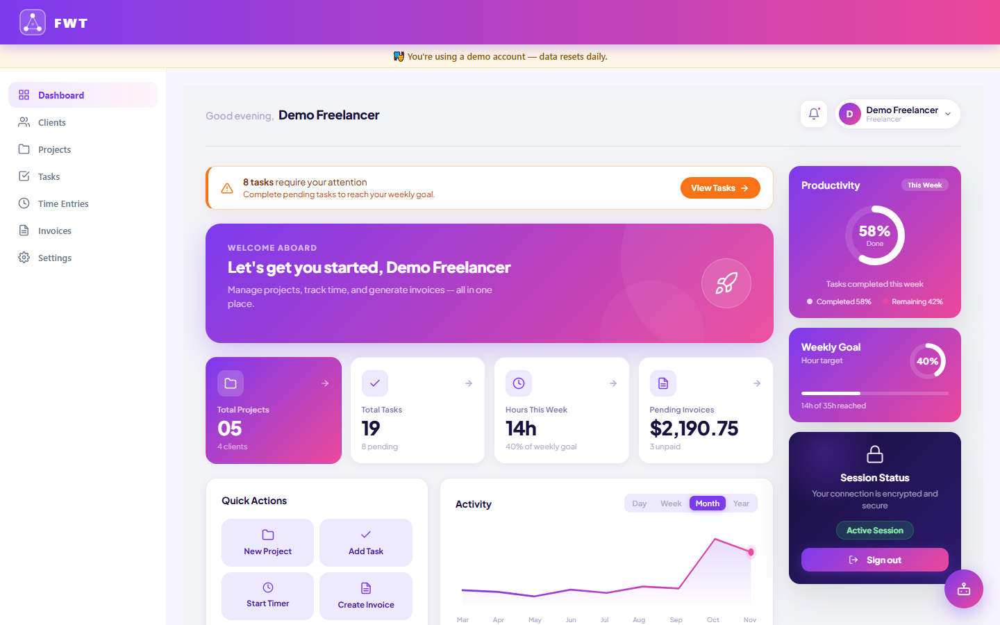
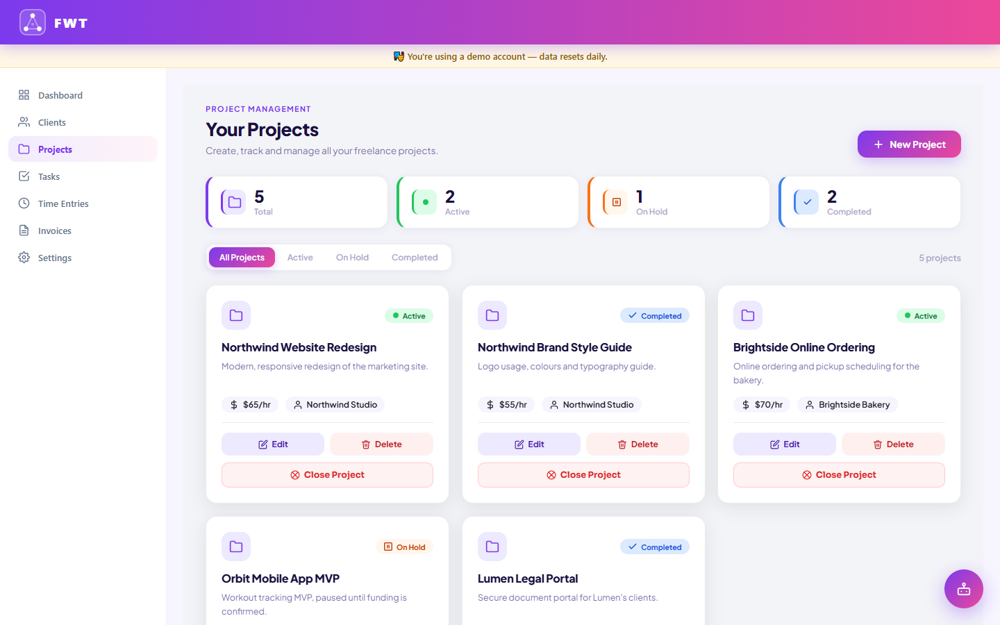
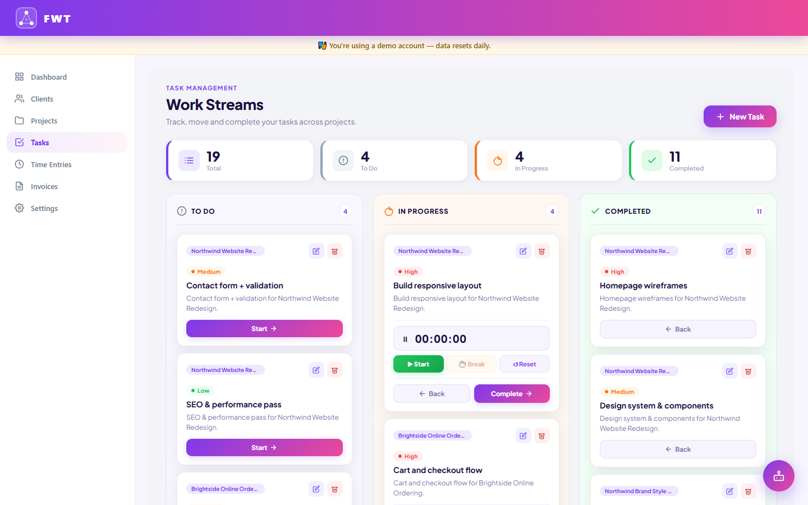
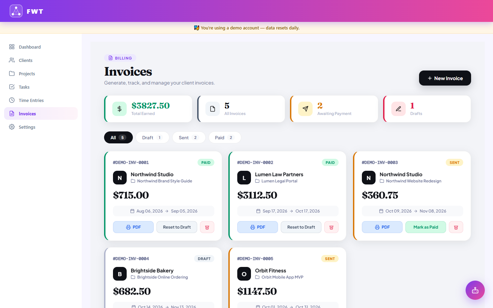
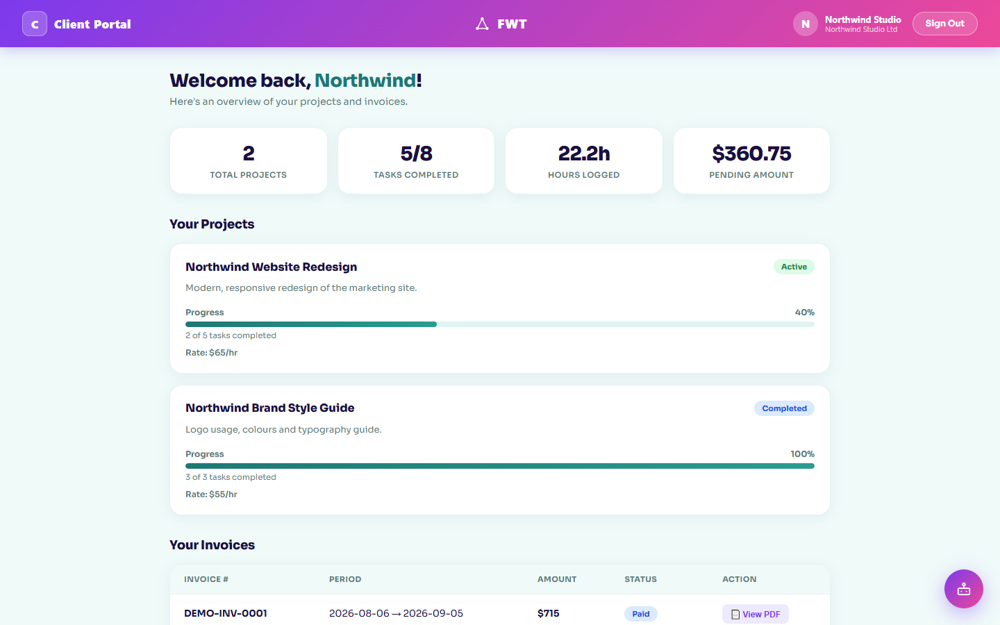
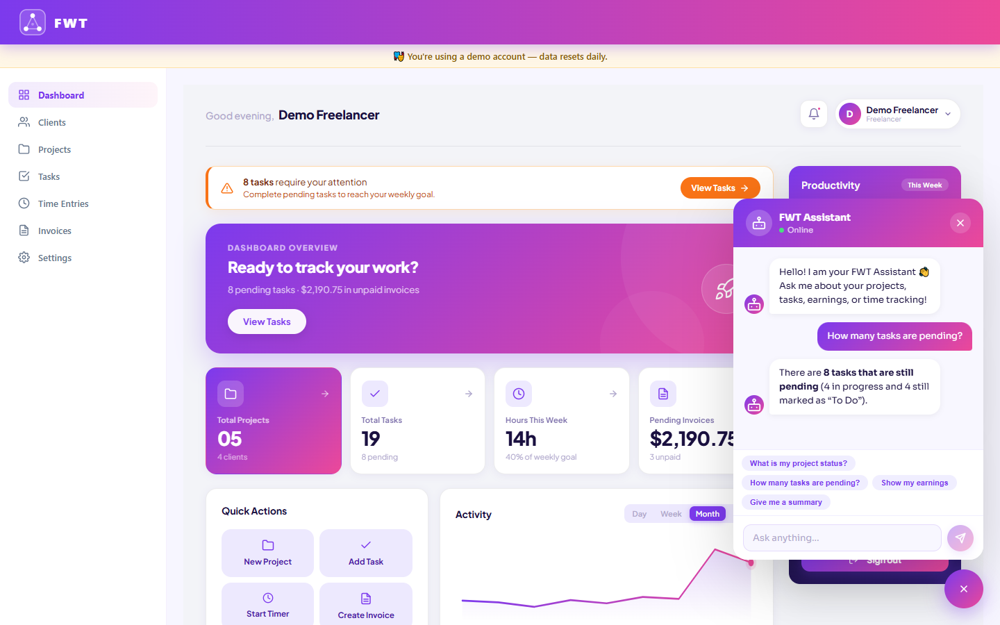
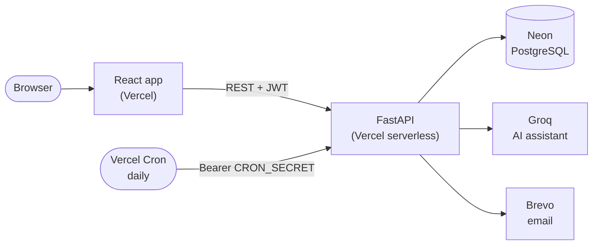

# FWT — Freelancer Work Tracker

**Manage clients, projects, time and invoices in one clean dashboard — with an AI assistant and a secure client portal.**


Developed by **Bisma Noreen** — solo Final Year Project, BS IT, University of Gujrat (2026).
Full stack (FastAPI + React + Groq AI) designed and built independently.

## Live demo

| | |
|---|---|
| **App** | [freelancer-work-tracker.vercel.app](https://freelancer-work-tracker.vercel.app) |
| **API docs (Swagger)** | [freelancer-work-tracker-hpnu.vercel.app/docs](https://freelancer-work-tracker-hpnu.vercel.app/docs) |

### Try it — no sign-up needed

- **Try the demo** (login page and landing page) signs you in as a sample freelancer with clients, projects, tasks, time entries and invoices already in place.
- **Try the client demo** (on the client login page) opens the client portal as one of that freelancer's clients.

The demo data **resets every day**, so feel free to click around, add and delete things. A few things are switched off in the demo on purpose: changing the password or email, and sending emails. The AI assistant is limited to 30 messages per day in the demo.

<!--
## Screenshots

Add images to docs/screenshots/ and uncomment this section, e.g.:

| Dashboard | Projects |
|---|---|
|  |  |
| Kanban tasks | Invoice preview |
|  |  |
| Client portal | AI assistant |
|  |  |
-->

---

## Features

**Freelancer dashboard**
- **Authentication** — register, log in, forgot/reset password by email, profile and password settings
- **Clients** — client list and detail pages with stats
- **Projects** — create, edit, filter and close projects with deadlines. Closing a project creates an invoice automatically and keeps it
- **Tasks** — Kanban board (To Do → In Progress → Done) with priorities
- **Time tracking** — live stopwatch (survives page refresh) plus manual entries; dashboard charts for weekly and monthly hours
- **Invoices** — draft → sent → paid, with PDF preview and print; an invoice keeps the project name even after the project is closed
- **Settings** — currency and tax preferences

**AI assistant (Groq)**
- Three assistants share one model: the landing-page bot, the freelancer assistant (answers from *your* real data) and the client-portal assistant
- Per-IP, per-user, per-client and global daily limits, stored in the database

**Client portal**
- Freelancers invite a client with a **secure, one-time "Set your password" link** (sent through Brevo). No password is ever emailed
- Clients see only their own projects, progress, hours and invoices, and have their own assistant

**Demo mode**
- One-click freelancer and client demos with realistic sample data, protections, and a daily reset (see [Try it](#try-it--no-sign-up-needed))

---

## Tech stack & architecture

| Layer | Technology |
|---|---|
| Frontend | React 19 (Create React App), React Router 7, Axios, hosted on **Vercel** |
| Backend | **FastAPI** + SQLAlchemy 2, deployed as a **Vercel serverless function** |
| Database | **PostgreSQL** on **Neon** |
| AI | **Groq** API (`openai/gpt-oss-20b` by default) |
| Email | **Brevo** transactional email API (over HTTPS) |
| Auth | JWT (python-jose), bcrypt password hashing (passlib) |
| Tests | Jest + React Testing Library |



### Project structure

```
freelancer-work-tracker/
├── frontend/                 # React app (CRA)
│   ├── src/
│   │   ├── pages/            # Screens (dashboard, projects, invoices, client portal, …)
│   │   ├── components/       # Layout, chat widget, markdown renderer, …
│   │   ├── api/              # axios instances (freelancer / client portal)
│   │   └── auth/             # session helpers and route guards
│   └── vercel.json           # SPA rewrite
│
└── backened/                 # FastAPI app (the folder name has a typo — see note below)
    ├── app/
    │   ├── routes/           # API endpoints
    │   ├── models/           # SQLAlchemy models
    │   ├── schemas/          # Pydantic schemas
    │   ├── services/         # Business logic (email, seed, chat quotas, …)
    │   └── main.py
    ├── migrations/           # SQL migrations for existing databases + runner
    ├── scripts/seed_demo.py  # Create/reset the demo account
    ├── create_tables.py      # Create tables on an empty database
    ├── pyproject.toml        # Dependencies + Vercel entrypoint
    └── vercel.json           # Daily cron for the demo reset
```

> **Note on folder naming:** the backend lives in `backened/` (not `backend/`) — that's a pre-existing typo baked into the project layout, not a typo in this README. Every command below uses the real folder name so copy-paste works.

---

## Security highlights

- **Secrets live only in environment variables.** `.env` files are git-ignored; `.env.example` files list the names with placeholders.
- **CORS is locked to the frontend origin(s)** set in `FRONTEND_URL` (localhost origins are also allowed for local development). Error responses never leak internal details.
- **JWTs carry a `purpose` claim.** Login, client-portal, password-reset and set-password tokens are not interchangeable: each endpoint accepts only its own kind.
- **Single-use, short-lived signed links.** Password-reset (30 min) and client invitation (24 h) links are bound to the account's current password, so they stop working once used.
- **Separate freelancer and client sessions.** Different storage keys, different API clients and different route guards, so one session can never be mistaken for the other. Both can be open in the same browser.
- **Database-backed rate limits** (serverless has no shared memory): daily caps per IP (stored as a salted hash, never the raw IP), per user, per client, and a global ceiling on AI usage. The AI endpoints fail closed if the counters can't be read.
- **Demo protections.** The demo accounts have no usable password (login is only through the demo endpoints), can't change email/password, can't trigger emails, and the daily reset is protected by a secret.
- **Passwords are hashed with bcrypt**, and database foreign keys define exactly what is cascaded or kept when records are deleted.

---

## Local setup

**Prerequisites:** Python 3.11+, Node.js 18+, a PostgreSQL database (a free [Neon](https://neon.tech) project works well, or a local PostgreSQL), and a [Groq API key](https://console.groq.com).

### 1. Backend

```bash
cd backened
python -m venv venv
venv\Scripts\activate        # Windows
# source venv/bin/activate   # macOS/Linux

pip install -r requirements.txt
cp .env.example .env         # then fill in your values (see below)
uvicorn app.main:app --reload
```

The API runs at `http://127.0.0.1:8000`, with interactive docs at `http://127.0.0.1:8000/docs`.

**Environment variables** (see [`backened/.env.example`](backened/.env.example) — names only, never commit real values):

| Variable | Required | Purpose |
|---|---|---|
| `DATABASE_URL` | Yes | PostgreSQL connection string (Neon: use `sslmode=require`) |
| `SECRET_KEY` | Yes | Signs JWTs, e.g. `python -c "import secrets; print(secrets.token_hex(32))"` |
| `ALGORITHM` | No | JWT algorithm (default `HS256`) |
| `ACCESS_TOKEN_EXPIRE_MINUTES` | No | Login token lifetime (default `60`) |
| `GROQ_API_KEY` | For AI chat | Without it the chat endpoints return 503; the rest of the app works |
| `GROQ_MODEL` | No | Defaults to `openai/gpt-oss-20b` |
| `FRONTEND_URL` | Yes | Allowed CORS origin(s), comma-separated; also used in email links |
| `BREVO_API_KEY`, `MAIL_FROM`, `MAIL_FROM_NAME` | For email | Without them emails are skipped and logged |
| `CRON_SECRET` | For demo reset | Protects `GET /internal/demo-reset` |
| `DEMO_USER_EMAIL`, `DEMO_CLIENT_EMAIL` | No | Demo account emails (defaults provided) |
| `CHAT_USER_DAILY_CAP`, `CHAT_CLIENT_DAILY_CAP`, `LANDING_IP_DAILY_CAP`, `LANDING_GLOBAL_DAILY_CAP`, `CHAT_GLOBAL_DAILY_CAP` | No | AI chat limits (defaults 200 / 50 / 10 / 300 / 1000 per day) |

**Database tables.** When you run the API locally, any missing tables are created automatically at startup. You can also run `python create_tables.py` on an empty database. For an *existing* database, apply the SQL files in `backened/migrations/` once, in order:

```bash
python migrations/run_migration.py migrations/001_fk_rules_and_invoice_project_name.sql
python migrations/run_migration.py migrations/002_demo_chat_usage.sql
python migrations/run_migration.py migrations/003_chat_usage.sql
```

**Optional — create the demo account locally:** `python scripts/seed_demo.py`

### 2. Frontend

```bash
cd frontend
npm install
cp .env.example .env         # optional: REACT_APP_API_URL (defaults to http://localhost:8000)
npm start                    # http://localhost:3000
```

| Variable | Purpose |
|---|---|
| `REACT_APP_API_URL` | Backend base URL, no trailing slash (see [`frontend/.env.example`](frontend/.env.example)) |

Run the tests with `npm test` and a production build with `npm run build`.

---

## Deployment (Vercel + Neon)

The frontend and backend are **two separate Vercel projects** from the same repository.

**Backend** — Root Directory `backened`
- Vercel detects the FastAPI app through `pyproject.toml` (dependencies and `entrypoint = "app.main:app"`); the Python version comes from `.python-version`.
- Add the environment variables from the table above. Use Neon's **pooled** connection string. The app uses a no-pool engine on Vercel, so serverless invocations don't hold connections.
- Tables are **not** created at startup on Vercel (to keep cold starts fast). Create them once against Neon with `python create_tables.py` (set `DATABASE_URL` to your Neon URL).
- **Demo reset cron:** `backened/vercel.json` schedules `GET /internal/demo-reset` once a day (03:00 UTC). Set `CRON_SECRET` in the project; Vercel sends it as `Authorization: Bearer <CRON_SECRET>`. Run `python scripts/seed_demo.py` once to create the demo account the first time.

**Frontend** — Root Directory `frontend`
- Set `REACT_APP_API_URL` to the backend URL and redeploy (Create React App reads it at build time).
- `vercel.json` rewrites all routes to `index.html`, so refreshing any page works.

Remember to set the backend's `FRONTEND_URL` to the deployed frontend URL.

---

## Developer

**Bisma Noreen** — sole developer
University of Gujrat — Final Year Project (FYP), 2026

- GitHub: [@explorewithBisma](https://github.com/explorewithBisma)

If you fork or build on this project, please keep this credit and link back to the original repository.

## License

MIT License © 2026 Bisma Noreen — see [LICENSE](LICENSE) for details.
Any copy or fork must keep the original copyright notice.
